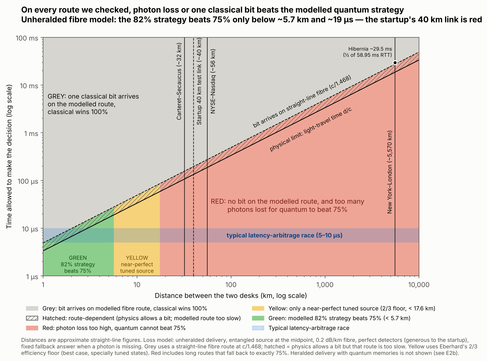

<!-- Generated from docs/README.template.md by scripts/render_deliverables.py. Edit the template, not README.md. -->
# The Photon That Didn't Show Up

[](https://github.com/udsy19/The-28-Millisecond-Monopoly/actions/workflows/ci.yml)
[](https://github.com/udsy19/The-28-Millisecond-Monopoly/actions/workflows/pages.yml)
[](LICENSE)
[](pyproject.toml)

**Website:** https://udsy19.github.io/The-28-Millisecond-Monopoly/ ·
**Memo (PDF):** [`reports/memo.pdf`](reports/memo.pdf) ·
**Case file:** [`case_file.md`](case_file.md)

An open, reproducible investment-diligence study. A (fictional) startup asks for $3M at a $25M
pre-money valuation to sell entanglement-based coordination, the CHSH game, to trading desks, starting with New York and
London. We treat every number in its case file as a claim, test each one in code, and ask one question carefully:
*is there any place where entangled photons beat the classical alternative a trading desk already has?* Built for
Columbia COMS 4995W *Lab-to-Market: Quantum and AI Innovation*, Challenge 03 ("The Quantum Trading Edge").

> **Research and teaching material, not investment advice.** The startup and its numbers are fictional. Nothing
> here executes trades or certifies any device.

## Key results

| Result | Value | Evidence |
|---|---|---|
| Best classical rule without communication (all 16 deterministic strategies) | 75% | `EXACT` brute force |
| Ideal quantum strategy (Born-rule singlet sampling, 1,000,000 rounds) | 85.4% | `EXACT` + `MONTE-CARLO` |
| One classical bit over the desks' existing line | 100% | `EXACT` |
| Startup's claimed 82% vs 75%, n = 1,000 | z = +5.1 (classical demo 74%: z = -0.7) | `CASE-FILE CLAIM` |
| Per-desk photon efficiency, 40 km link (0.2 dB/km, midpoint source) | 0.398; both photons arrive in 16% of rounds | `MODEL` + `MONTE-CARLO` |
| **All-rounds win rate on the startup's own 40 km link** | **64.1%** (82% source), 64.7% (ideal) | `MODEL` + `MONTE-CARLO` |
| Break-even efficiency → max desk separation | 87.7% → 5.7 km (ideal source 8.2 km; Eberhard best case 17.6 km) | `MODEL` |
| Classical cheater that discards rounds (detection loophole) | 82% on kept rounds, 75% overall, 78.1% kept | `EXACT` + `MONTE-CARLO` |
| Edge per round: claimed vs every-round accounting | $13.92 vs −$21.82 | `MODEL` (payoff invented by the case) |
| Quantum edge with biased signals (Ding & Jiang Thm 10) | only when signals fire 29%–71% of the time | `PUBLISHED` + independent check |

**Recommendation: do not invest at this valuation.** The physics is real, but the 82% headline and the
40 km link cannot both hold for a trading desk: a desk must answer every round, and on that link photon loss pushes
the quantum strategy below the free classical rule. Quantum could only pay within 5.7 km and under 19 µs
decisions, and with any time to communicate one classical bit wins every round.



### Negative results, limitations and corrections (kept deliberately)

1. The lost-photon fallback is a simple model (a desk without its photon plays a fixed answer). Smarter fallbacks lower
   the bar, but never past Eberhard's best case (17.6 km), which we report.
2. Heralded delivery with quantum memories removes the photon-loss penalty in principle (win rate never below
   75%). The startup has not claimed memories, and it does nothing for New York–London.
3. Perfect detectors are assumed (generous to the startup). Lower-loss fibre helps slowly: at 0.17 dB/km the 82% source
   reaches 6.7 km; a hypothetical 0.1 dB/km fibre gives 11.4 km.
4. We checked three real routes (32–56 km) and New York–London, not every pair of facilities within a few kilometres.
5. The ±$100 payoff and the $50M claim are the case's own and were not matched to a real trade.

Full record: [`DECISIONS.md`](DECISIONS.md) (every judgment call and every fix) ·
independent review: [`review/review.md`](review/review.md) · assumptions: [`deliverables/assumptions.md`](deliverables/assumptions.md).

## What is in the repository

| Path | Contents |
|---|---|
| `src/chsh.py` | Pure, documented model: classical brute force, singlet sampling, photon loss, heralding, cheater, frontier, biased inputs, economics |
| `analysis.ipynb` | Experiments E1–E6 and E2b, generated by `scripts/build_notebook.py`; executed copy `analysis_executed.ipynb` |
| `results/results.json` | Every computed value (`values`) and the exact strings the writing uses (`display`) |
| `figures/` | Main figure and supporting figures at 300 dpi (generated, never hand-edited) |
| `deliverables/` | Phase 1 plan, memo, claims ledger, assumptions, evidence register, steelman/rebuttal, one-page brief, oral script — rendered from `deliverables/templates/` |
| `reports/` | PDFs of the memo, Phase 1 plan and one-page brief |
| `site/` | Static website; `site/model.js` is a line-for-line port of `src/chsh.py` |
| `tests/` | Expected values (`test_chsh.py`), Python–browser parity (`test_parity.py`), site integrity (`test_site.py`) |
| `scripts/` | Notebook builder, renderer, number checker, PDF build, site build, packaging |
| `review/`, `DECISIONS.md`, `PLAN.md` | Independent review, judgment calls, build checklist |

## Quick start

Requirements: Python 3.13; Node 22 for the parity tests, PDFs and screenshots; `pandoc` for PDFs.

```bash
git clone https://github.com/udsy19/The-28-Millisecond-Monopoly && cd The-28-Millisecond-Monopoly
python3.13 -m venv .venv && . .venv/bin/activate
pip install -r requirements.txt
python -m pytest -q                      # expected values, parity, site integrity
scripts/package.sh                       # notebook → results.json → deliverables → PDFs → submission.zip
```

Fixed seed 20261119: re-running produces a byte-identical `results/results.json`. Preview the website locally:

```bash
python scripts/build_site.py --out _site && python -m http.server -d _site 8000
```

## How a number reaches the memo

`src/chsh.py` → `analysis.ipynb` → `results/results.json` → `deliverables/templates/*.md` (each double-brace placeholder is
filled by `scripts/render_deliverables.py`) → `scripts/check_numbers.py` (fails CI on any number it cannot trace) →
PDFs and website. The website reads the same `results.json` at runtime.

## Citing, contributing, security

- Cite with [`CITATION.cff`](CITATION.cff); please also cite Ding & Jiang (arXiv:2407.21723) and the other sources in the memo.
- Contributions: [`CONTRIBUTING.md`](CONTRIBUTING.md) · conduct: [`CODE_OF_CONDUCT.md`](CODE_OF_CONDUCT.md) ·
  security: [`SECURITY.md`](SECURITY.md) · changes: [`CHANGELOG.md`](CHANGELOG.md).
- Disclosure of the case file, sources and AI assistance (built with Claude Code): [`DISCLOSURE.md`](DISCLOSURE.md).

## License

MIT — see [`LICENSE`](LICENSE). Cited papers, the patent and website fonts keep their own licences.
