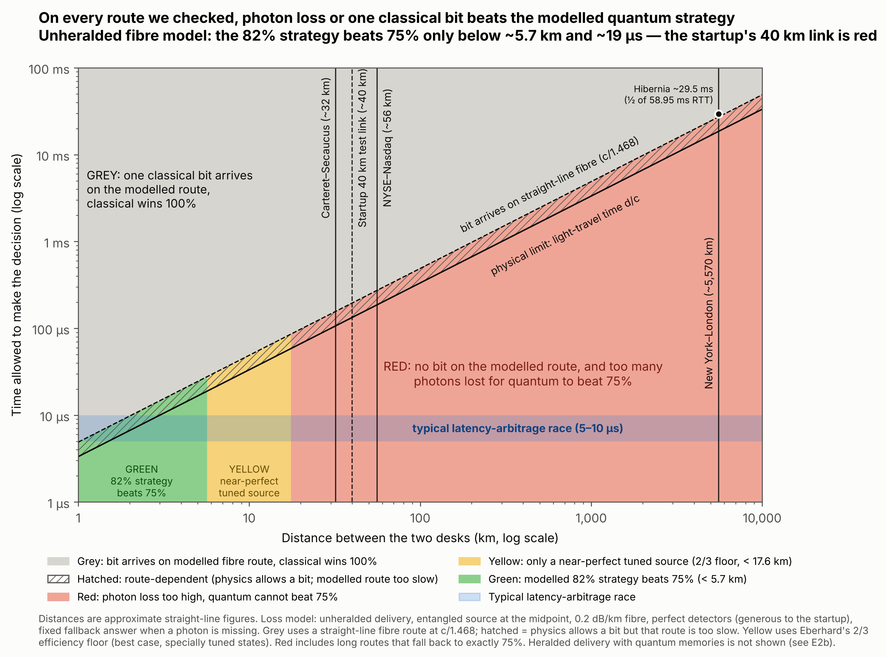

# The Photon That Didn't Show Up

**Recommendation: do not invest $3M at a $25M pre-money valuation.** The physics is real, but under our model of the startup's own setup (photons sent unheralded over fibre, a desk that must act on every round), its two headline numbers, 82% quantum success and a 40 km fibre link, cannot both hold for a trading desk, and no one has named a trade that pays like the game being sold.

## What is being sold, and what we tested

The product is a coordination game: two desks each get a yes/no signal and must answer without talking. Entanglement (linked photon pairs shared in advance) lets them coordinate more often than any classical (ordinary, non-quantum) rule. We rebuilt it in code and tested every case-file number.

- **The physics checks out.** The best rule without communication wins 75% of rounds; the ideal quantum strategy wins 85.4%. The startup's own classical demo (74%) is a fair baseline, statistically consistent with 75%.
- **But the desks already share a private line.** If there is time to send one bit, a simple classical rule wins 100% of rounds. Quantum only matters when the decision must be made faster than light can travel between the desks.

## The finding: photons go missing, and a desk cannot skip rounds

A lab throws away rounds where a photon is lost. A trading desk must answer every round, and it cannot tell whether its partner's photon arrived. On the startup's own 40 km link only about 40% of photons reach each desk, so both arrive in just 16% of rounds. Counting every round, a source of the startup's quality wins **64.1%**, which is *worse* than the free 75% rule. To beat 75%, each desk must receive 87.7% of its photons, so the modelled 82% strategy only wins below about **5.7 km** under idealized assumptions (an ideal source: 8.2 km; specially tuned states at Eberhard's floor: 17.6 km). Stored, pre-confirmed pairs (heralding) have no fixed distance cutoff, but are limited by pair supply and quantum memories the startup has not claimed.

So an 82% rate on rounds where both photons were detected is consistent with this link; an 82% rate over all attempted rounds is not. If the 1,000 trials were both-photon rounds, about 6,310 rounds were attempted; the startup's denominator and protocol are unverified. A purely classical "cheater" that quietly discards some rounds scores exactly 82% with no quantum hardware at all, so the headline proves nothing without the discard count.

*Figure. Distance between desks (across) vs time allowed to decide (up). Grey: one bit arrives on a straight fibre route and wins every round; hatched: physics allows a bit but that route is too slow. Red: too many photons lost to beat the classical rule. Green, where the modelled 82% strategy wins, is under 5.7 km apart and, where no bit can arrive at all, under 19 µs (millionths of a second). NYSE–Nasdaq scores 65.6% counting every round; New York–London is grey for decisions slower than about 29.5 ms (half the Hibernia round-trip benchmark), route-dependent down to 18.6 ms, and red below that.*

## The money does not add up either

On the startup's own numbers the edge is $13.92 per round, so $50M a year needs 3.59 million rounds. Counting every round on the 40 km link, the edge is **−$21.82 per round**: a desk would switch the photons off and take the free 75%, so the product is worth nothing there (used as sold, it would lose about $78M a year). The ±$100 payoff is invented by the case, and $50M of profit would be 1.0% of the ~$5B a year global equities latency-arbitrage market (traders profiting from being microseconds faster), a generous comparator for block orders. The edge also vanishes unless each desk's signal fires between 29% and 71% of the time; no trade has been named.

## Did our hypothesis survive?

**Yes: the decision (pass) survived, but the reason changed.** We expected the shared private line to settle it: one classical bit beats entanglement whenever there is time to send it, which rules out New York–London. That alone leaves the founders a retreat to faster, closer trades. Photon loss closes it, under our unheralded model: in the only window where the bit cannot arrive in time, the photons do not arrive either. The evidence does not show a usable, profitable service; it does not disprove every possible version of one.

## Questions for the founders

1. Over what link, and from how many attempted rounds, were the 1,000 trials scored?
2. What is the end-to-end efficiency per desk (fibre, optics and detectors)?
3. Which real trade has this payoff, and how often is each signal seen?
4. What does the protocol do when one photon is missing?
5. Can you sell without licensing the earlier patent on coordinating non-communicating parties (Szegedy, Ding & Shi), i.e. do you have freedom to operate?

## What would reopen the deal

- Logs of *every* attempted round showing better than 75% between desks too far apart for a bit to arrive in time.
- Heralded delivery with quantum memories (stored photons plus a signal confirming both arrived), with pair supply shown for the actual route: not claimed, and no help over direct transatlantic fibre.
- A named trade with signals inside the window and a payoff tied to real profit and loss, at a research-stage valuation.

## A pivot worth testing (unproven hypothesis)

The hardware may suit markets where entanglement *is* the product: certified randomness (provably unpredictable random numbers, already shown on a quantum computer by Liu et al.) or device-independent key distribution (encryption keys secure even on untrusted hardware). These still need high photon efficiency, but they do not have to beat a classical bit or match a trade. A hypothesis to test, not a proven market.

## Limitations

Our loss model is simple (a desk missing its photon plays a fixed answer); cleverer fallbacks lower the bar, but never past the best case we report (17.6 km). Perfect detectors are generous to the startup. The 5–10 µs race window comes from equity latency arbitrage, a different market from block orders; we use it only as the fastest documented decision time. We modelled fibre only, not satellites. The payoff and the $50M claim are the case's own and could not be checked against a real trade.

## Sources

- Ding & Jiang, "Coordinating Decisions via Quantum Telepathy," arXiv:2407.21723: NYSE–Nasdaq hedging model, fibre insufficient, the 2/3 efficiency floor, nonuniform-input theorem.
- Szegedy, Ding & Shi, US Patent 11676104B2: coordinating decisions between non-communicating parties.
- Mermin (1986); Eberhard, Phys. Rev. A 47, R747 (1993): 82.8% and 66.7% detection-efficiency thresholds.
- Hibernia Express (2015): New York–London round trip under 58.95 ms.
- Aquilina, Budish & O'Neill, QJE 137(1), 2022: latency races last ~5–10 µs; ~$5B a year globally.
- Liu et al., Nature 640, 343 (2025): certified randomness on a quantum computer, 71,313 bits.

*Experiment: `analysis.ipynb` (executed copy `analysis_executed.html`), fixed seed 20261119, 1,000,000 simulated rounds per Monte Carlo check; every number above is read from `results/results.json`.*
